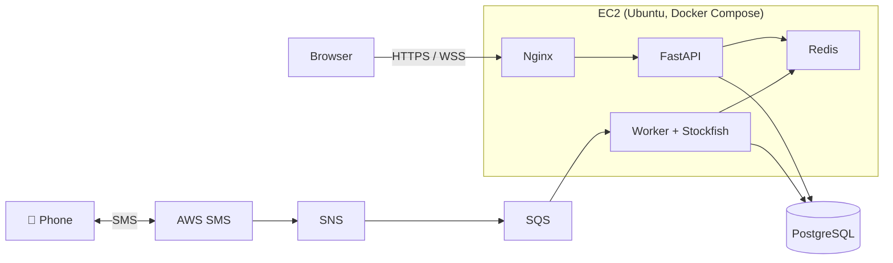

# ♟️ text2chess

[](https://github.com/opssonu/text2chess/actions/workflows/ci.yml)

Play chess with friends, random opponents or skill-matched bots, **and play slow games by text message**. When it's your turn you get an SMS; reply with `e5`, `Nf3` or `knight to f3`, and you never have to open the app.

> 🚧 Work in progress. Portfolio project showing Python backend development and AWS / Linux / DevOps / SRE practices.

## Tech stack

| Layer | Tech |
|---|---|
| Backend | Python 3.12, FastAPI (REST + WebSockets), SQLAlchemy 2 (async), Alembic, `python-chess` |
| Workers | arq (Redis): bot moves (Stockfish), SMS, clock timeouts |
| Data | PostgreSQL 16, Redis 7 |
| Frontend | React + TypeScript (Vite) |
| Infra | AWS (EC2 Ubuntu, RDS, ECR, SNS/SQS, End User Messaging SMS, Route 53, CloudWatch), Terraform, Docker, Nginx |
| CI/CD | GitHub Actions: lint, tests, image build, smoke test, Trivy scan → (later) deploy via OIDC + SSM |

## Architecture



## Local development

Requirements: Docker + Docker Compose (WSL2/Linux/macOS) and `make`.

```bash
make up        # builds and starts api, worker, frontend, postgres, redis
make ps        # service status
make test      # backend tests (incl. integration)
make lint      # ruff + eslint
make logs      # tail logs
make down      # stop
```

| URL | What |
|---|---|
| http://localhost:5173 | Frontend |
| http://localhost:8000/docs | API docs (OpenAPI) |
| http://localhost:8000/health | Liveness probe |
| http://localhost:8000/ready | Readiness probe (DB + Redis) |

## Repo layout

```
backend/     FastAPI app, worker, Alembic migrations, tests
frontend/    React + TypeScript (Vite)
infra/       Terraform, Nginx, cloud-init (coming in Phase 3)
docs/        Architecture decisions, runbooks
.github/     CI/CD workflows
```

## Roadmap

- [x] **Phase 0:** repo, local Docker stack, CI
- [ ] **Phase 1:** auth, play vs Stockfish bots, game persistence
- [ ] **Phase 2:** live multiplayer (WebSockets), friend invites, clocks, matchmaking
- [ ] **Phase 3:** AWS deploy: Terraform, EC2 + RDS, Nginx/TLS, CD via OIDC + SSM
- [ ] **Phase 4:** play-by-SMS correspondence games
- [ ] **Phase 5:** monitoring, alarms, backups, load testing, runbooks

